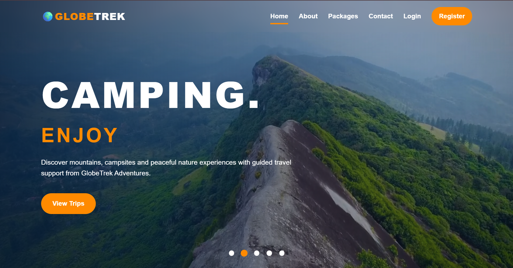
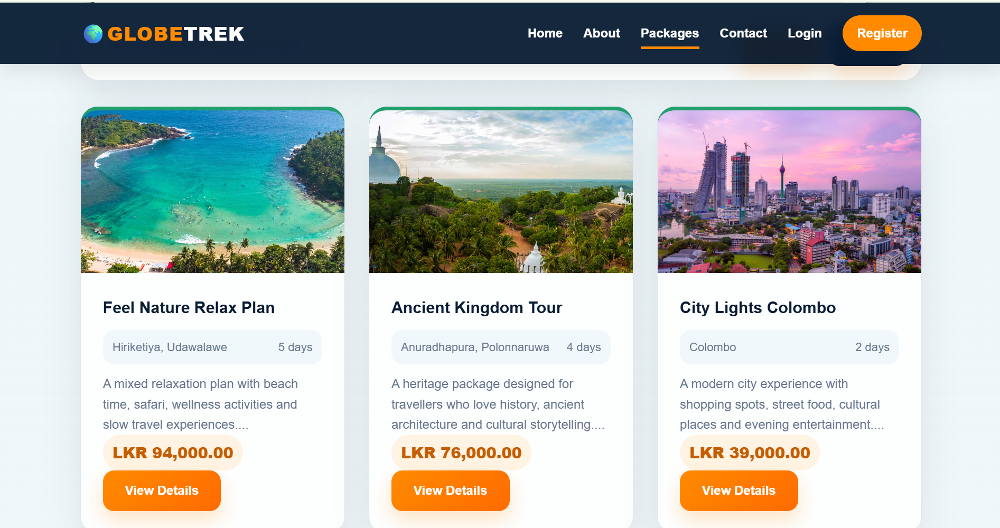
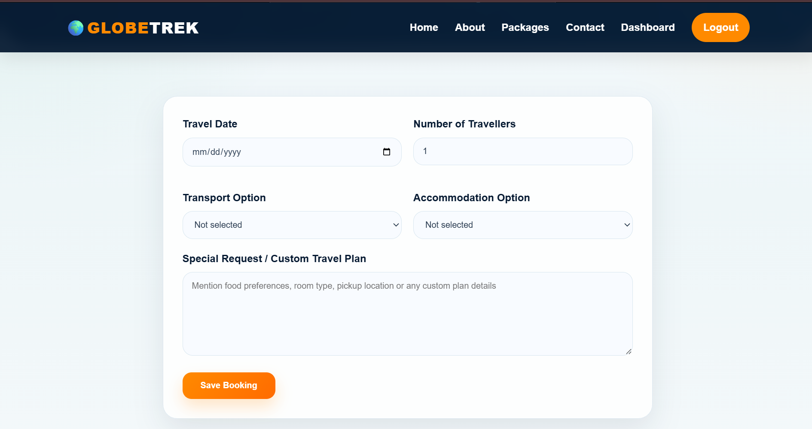
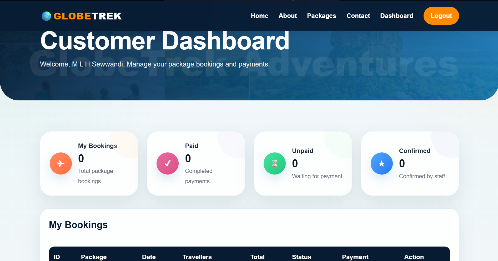
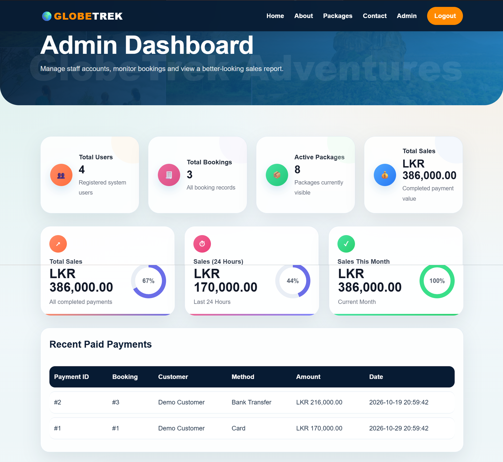


# GlobeTrek Adventures

A web-based Travel and Tourism Management System developed using PHP, MySQL, HTML, CSS, and JavaScript.

## Project Overview

GlobeTrek Adventures is a travel and tourism management platform that allows customers to explore travel packages, make bookings, and manage their reservations.

The system provides separate functionality for customers, staff members, and administrators, supporting travel package management, booking operations, and customer services.

## Key Features

### Customer Features
- User registration and login
- Browse and search travel packages
- View detailed package information
- Make travel bookings
- Track bookings through a customer dashboard
- Submit inquiries through the contact page

### Staff Features
- Manage travel packages
- View and manage customer bookings
- Review customer inquiries

### Administrator Features
- Dashboard with booking and sales statistics
- User management
- Staff account creation
- Travel package management
- Booking monitoring
- Sales reporting

### Payment Features
- Demonstration payment workflow
- Payment records and booking status updates
- Payment information displayed in dashboards

**Note:** The payment functionality is simulated for educational purposes. No real payment gateway is integrated.

## Technologies Used

| Category | Technologies |
|---|---|
| Frontend | HTML5, CSS3, JavaScript |
| Backend | PHP |
| Database | MySQL |
| Development Environment | XAMPP |
| Version Control | Git, GitHub |

## Project Screenshots

### Homepage



### Travel Packages



### Booking System



### Customer Dashboard



### Admin Dashboard



## Project Structure

```text
globetrek-adventures/
|
|-- assets/
|   |-- css/
|   |-- images/
|   |-- js/
|   |-- videos/
|
|-- partials/
|   |-- header.php
|   |-- footer.php
|
|-- docs/
|   |-- screenshots/
|
|-- index.php
|-- about.php
|-- packages.php
|-- package-details.php
|-- booking.php
|-- payment.php
|-- contact.php
|-- login.php
|-- register.php
|-- logout.php
|-- customer-dashboard.php
|-- staff-dashboard.php
|-- admin-dashboard.php
|-- manage-package.php
|-- delete-package.php
|-- config.example.php
|-- .gitignore
|-- README.md
```

## Local Installation

### Requirements

- XAMPP with Apache and MySQL
- PHP
- Web browser

### Setup Instructions

1. Install XAMPP on your computer.
2. Clone or download this repository.
3. Place the project folder inside the XAMPP `htdocs` directory.
4. Start Apache and MySQL using the XAMPP Control Panel.
5. Create a MySQL database named `globetrek_db`.
6. Import the local database SQL file when available.
7. Create a local `config.php` using `config.example.php` as a reference.
8. Configure the database connection.
9. Open the application using your local project folder URL.

Example:

`http://localhost/globetrek-adventures/`

**Note:** The database dump and local database credentials are excluded from this public repository. A sanitized database schema is planned for a future update.

## Security Notes

The project includes authentication and role-based functionality, with database operations and access restrictions implemented in the application.

- Password hashing and verification
- Role-based user functionality
- Database operations using prepared statements
- Local database credentials excluded from Git version control

This is an educational project and requires additional security testing and review before production deployment.

## Project Status

**Status:** Academic Project / Portfolio Demonstration

The application has been developed for educational purposes and local testing.

Future improvements may include:
- Additional validation and security enhancements
- Responsive design improvements
- Deployment using PHP and MySQL hosting
- Automated testing
- Improved database setup documentation

## Developer

**Hansanee Sewwandi**

Software Engineering Undergraduate

[GitHub Profile](https://github.com/hansaneesewwandi)

---

**GlobeTrek Adventures — Travel and Tourism Management System**
